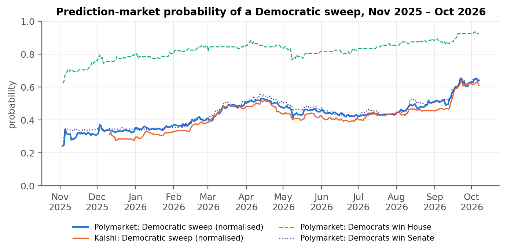
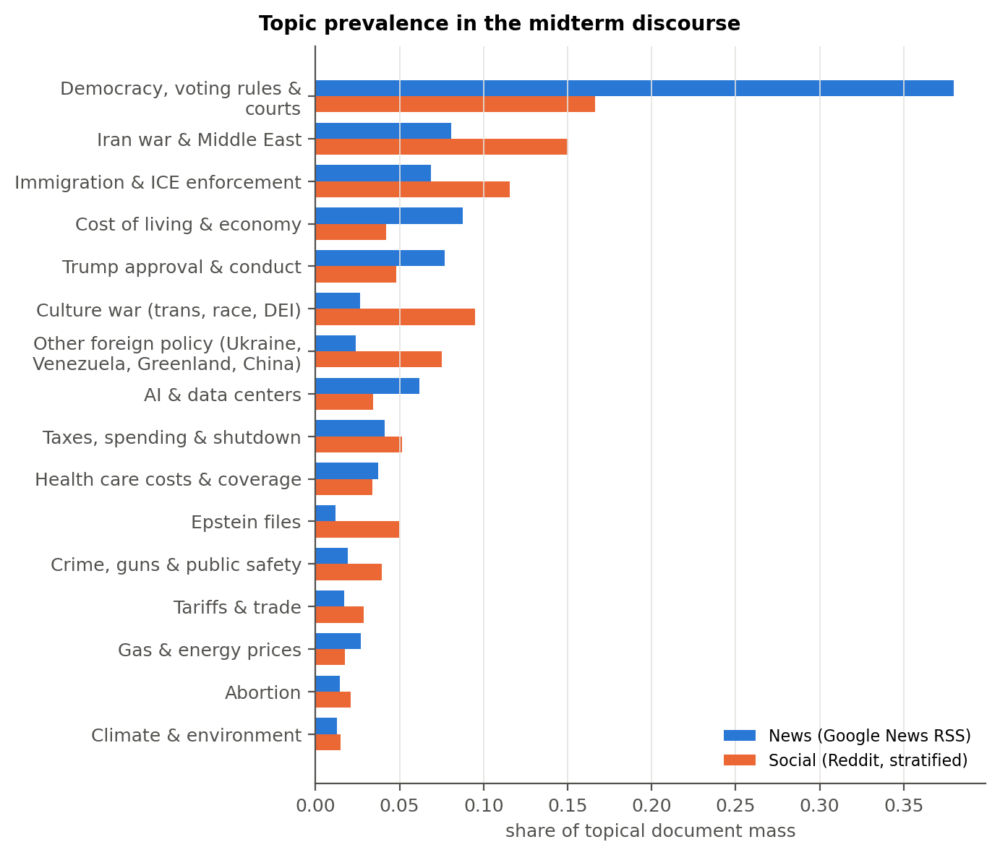
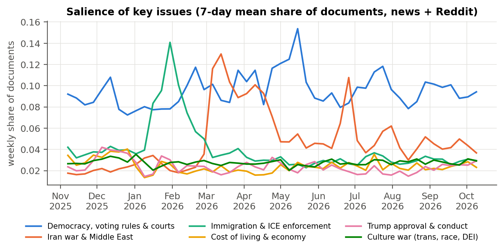
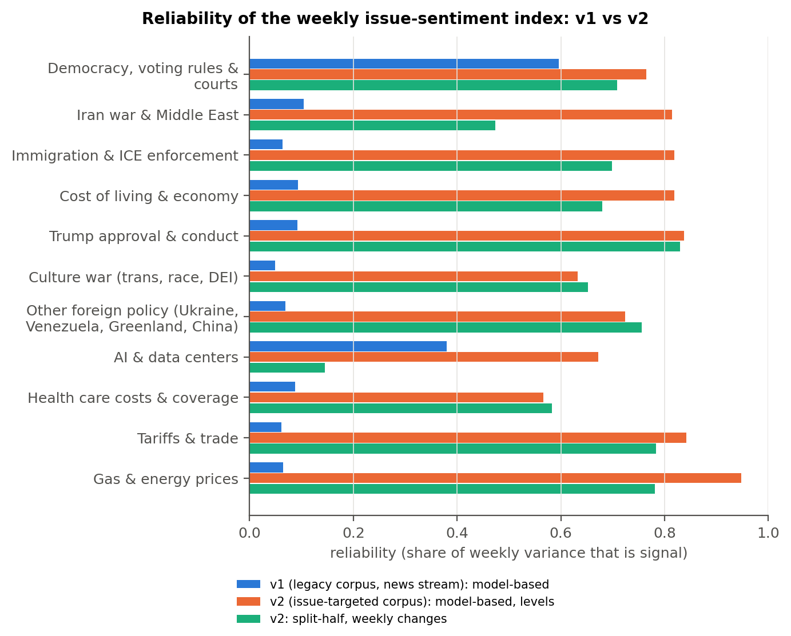
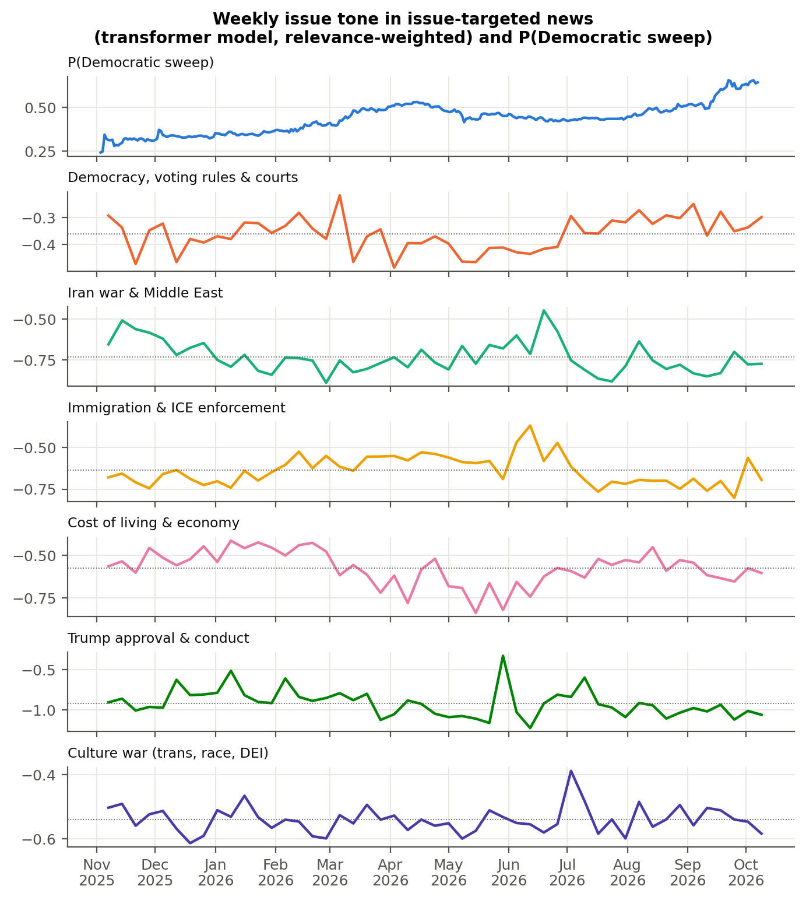
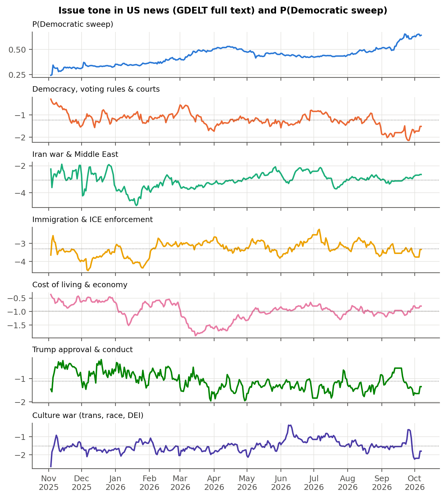
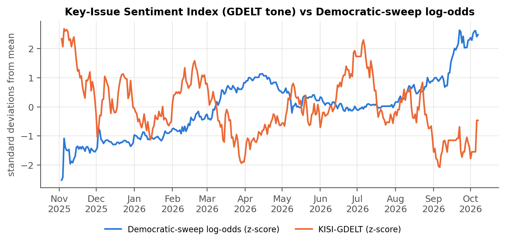
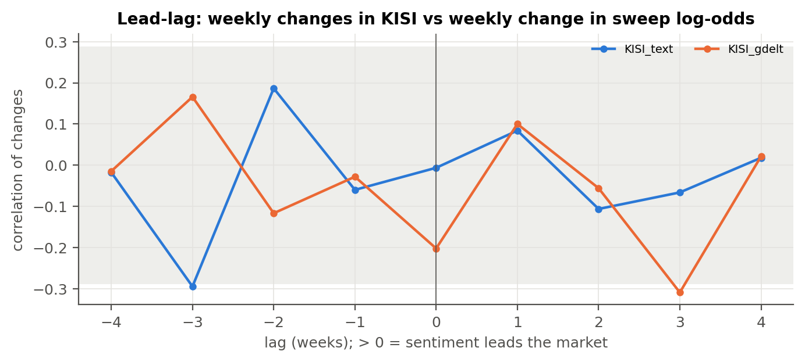
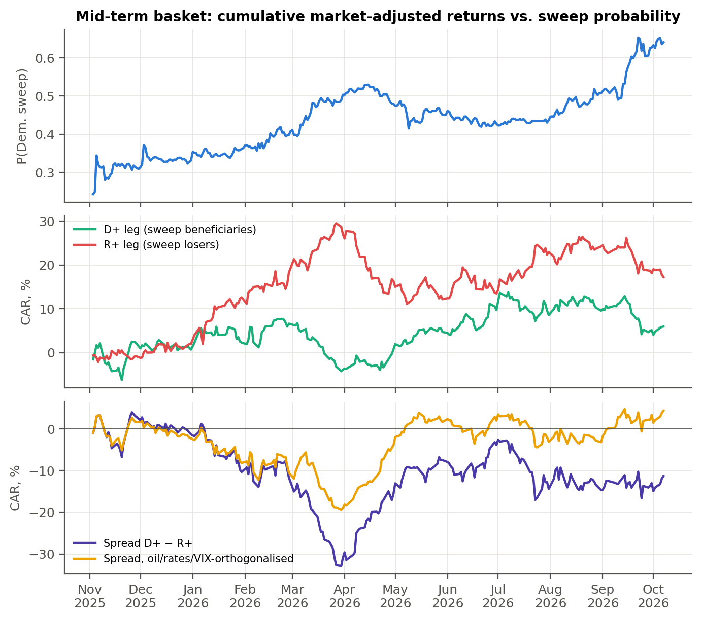
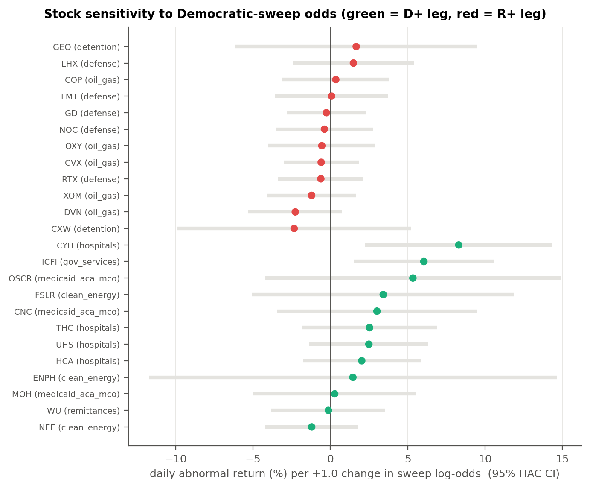

# Abstract

We study which issues dominate the 2026 US midterm discourse, whether issue sentiment can be measured reliably week by week, and how it relates to the market-implied probability of a Democratic sweep and to a politically exposed equity basket. Only 29% of election news and 49% of political Reddit posts concern a policy issue. Democracy and voting rules, the Iran war and immigration lead issue discourse, while polls rank the economy first. A validated transformer index built from 89,056 issue-targeted headlines reaches a hold-out Spearman correlation of 0.70 (0.77 against an independent coder) and weekly split-half reliability of 0.83 for levels and 0.70 for changes. Worse tone on energy prices, cost of living and Trump's standing accompanies rising sweep odds in levels; a week-to-week link appears only for GDELT energy tone after the Iran war began. A pre-specified long–short basket lost 11.3% market-adjusted while sweep odds rose from 24% to 64%, because its oil and defence leg tracked the war; after removing oil, rate and VIX exposure it gained 4.4%. The estimates describe co-movement, not causal effects.

# 1. Research design

| Component | Source | Coverage | Output |
|---|---|---|---|
| Election odds | Polymarket "2026 Balance of Power" (5 outcomes; hourly CLOB prices) [1]; Kalshi `KXBALANCEPOWERCOMBO-27FEB-*` (daily candles) [2]; House/Senate control markets | Jul-2025 → 8-Oct-2026 | P(Dem sweep), renormalised over the four party-control combinations (the residual "other" outcome averages 0.5%), sampled 16:00 ET |
| Election news corpus | Google News RSS, US-English edition [3]; issue-neutral queries *midterms, voters poll, midterm campaign, Senate race, House race, voters say* | 49 weekly windows; 24,052 items → 18,578 unique headlines | topic discovery, issue salience |
| Social corpus | Reddit via Arctic Shift archive [4]: r/politics, r/democrats, r/AskALiberal (left); r/PoliticalDiscussion, r/moderatepolitics (centre); r/Conservative, r/Republican, r/AskConservatives (right) | r/politics: 100 posts on one day per week; other communities: all posts. 77,391 posts retrieved → 23,386 after uniform hash-based thinning (≤40 per r/politics day, ≤12 per other community-day) | stratified salience; descriptive partisan sentiment |
| Issue-targeted news corpus | Google News RSS, one keyword query per key issue (`config/topic_queries.yaml`) | 170 two-day windows × 11 issues = 1,870 requests; 127,126 items → 89,056 headlines | issue sentiment (primary text index) |
| Annotations (v2) | codebook annotation reviewed and confirmed by researchers under written guidelines (`data/annotations/GUIDELINES_issue_v2.md`); independent coding of 110 hold-out items | 1,430 training + 550 random hold-out headlines | relevance and tone models; validation |
| News tone | GDELT DOC 2.0 `timelinetone` [5], the same keyword queries restricted to US English sources | daily | KISI-GDELT |
| Equities | Yahoo Finance adjusted closes [6]: 24 basket stocks, SPY, sector ETFs, WTI, 10-y yield, VIX | Jan-2024 → 7-Oct-2026 | market-adjusted returns |
| External validation | Emerson (Sep 2026) [7], Deseret/Hinckley–Morning Consult (Sep 2026) [8], AP/KFF rural (Aug 2026) [9] | — | triangulation of the issue ranking |

Table: Data sources and coverage

The election corpora use issue-neutral queries, so the issue ranking does not presuppose any policy topic. The issue-targeted corpus is drawn *after* the key issues were chosen: it measures sentiment about those issues, not their salience. Its keyword sets are the GDELT queries, so the two sentiment instruments measure the same construct and can be cross-validated. The study window starts the day before the 4 November 2025 off-year elections and ends one day before data retrieval.

**Data-collection note.** Part of the initial collection was done in a browser and transferred to the repository in check-summed chunks (FNV-1a over UTF-16 code units, unit-tested). The GDELT series were later re-collected with the repository's Python collectors and matched the browser-collected files exactly (all 13 series, every day). The issue-targeted corpus and the two additional GDELT series were collected directly with the same collectors. The issue-targeted corpus was collected in two date ranges and merged; it is complete, with all 1,870 requests and no duplicates.

# 2. The odds backdrop

The renormalised Polymarket sweep probability moved as follows:

- **Off-year elections.** It was 24% on 3 November 2025 and jumped to 34% on 5 November, the day after the off-year elections. That is the largest daily move in the sample: +0.46 in log-odds.
- **Iran war.** It was 40% on 27 February 2026, the eve of the US–Israeli strikes on Iran [10]. It peaked at 53% in mid-April and drifted back to 43% by late June.
- **Autumn.** It then climbed to 51% (1 September), 59% (17 September; cf. [11]) and **64% on 7 October**. On the same date Kalshi's DD contract stood at 61%, the Democratic House at 92.5% and the Democratic Senate at 64.5%.

The two venues agree closely: the level correlation is 0.98 and the correlation of weekly changes is 0.88. The Senate is the binding constraint: a sweep is almost exactly the probability that Democrats win the Senate.

# 3. Which topics do voters care about?

## 3.1 Unsupervised topic modelling

We first ran non-negative matrix factorisation (NMF) [12] on TF-IDF features of the pooled election corpus. The fitting sample was balanced between news and Reddit, and we used a K grid of 10–40 with NNDSVDa initialisation and three seeds. K was chosen by mean NPMI coherence [13, 14] computed over the full corpus. The selected K = 35 has mean NPMI 0.067 and seed stability 0.76. An LDA run with the same K is a weak match (mean top-10 Jaccard 0.19), which is typical for short texts.

Reading the 35 topics, their top terms and eight representative documents each (`config/topic_labels_stage1.yaml`) gives the study's first substantive result: **27 of 35 topics are election process, not policy**. They cover races (Texas, Maine, North Carolina…), primaries, results, candidates, party labels, ballots and subreddit meta-text. Only eight are issue topics: Trump/economy/tariffs, the Iran war, the Supreme Court and maps, voting rights, the Epstein files, Trump's approval, data centres, and ICE/immigration.

We then removed every term whose loading mass sits ≥80% in process topics (6,091 of 11,106 terms) and refitted. Coherence turned negative (mean NPMI −0.12 at the best K). Issue content in headlines and post titles is too sparse and too lexically diverse for bag-of-words NMF to isolate health care, cost of living or energy prices as topics. Unsupervised modelling therefore *discovers* the issue space and shows that process content dominates, but it cannot *measure* issues reliably on its own.

## 3.2 Issue taxonomy and supervised scaling

Issue assignment combines a fixed codebook, researcher-reviewed annotations, and a supervised classifier for corpus-wide estimation.

1. **Taxonomy.** Seventeen issue categories plus NONE. They come from the NMF topics plus open coding of random documents (e.g., cost of living, gas and energy prices, health care, immigration/ICE, Iran war, democracy/voting rules/courts, Epstein, AI/data centres, culture war).
2. **Annotation.** Researchers applied the fixed codebook to the documents and reviewed the resulting issue labels:
   - 1,220 *training* documents: 500 random plus 720 keyword-retrieved to enrich rare issues. A third of the retrieved documents were labelled NONE or a different issue.
   - Two purely random *hold-out* sets: 264 news headlines and 304 Reddit posts.
3. **Model.** TF-IDF of word 1–2-grams and character 3–5-grams feeding a multinomial logistic regression (C by 5-fold CV).
4. **Hold-out performance:**

| Hold-out set | Accuracy | Issue vs. none | True issue share | Estimated (PCC) | Mean abs. prevalence error per class |
|---|---|---|---|---|---|
| News (264) | 0.80 | 0.83 | 33.0% | 34.9% | 0.9 pp |
| Reddit (304) | 0.63 | 0.70 | 59.9% | 54.2% | 1.1 pp |

Table: Issue-classifier performance on the random hold-out sets

Prevalence is estimated by probabilistic classify-and-count (PCC). We also tested the Saerens–Latinne–Decaestecker EM prior-shift correction [15]. It *raised* the error (1.5 and 2.9 pp) because the posteriors are not calibrated enough, so it is reported only as a diagnostic.

## 3.3 Ranking and triangulation

| Rank | Issue | News | Reddit (avg. of L/C/R) | Combined | Trend (last 8w vs first 8w) | Emerson Sep-26: most important issue | Emerson: importance (1–5) |
|---|---|---|---|---|---|---|---|
| 1 | Democracy, voting rules & courts | 38.0% | 16.6% | 27.3% | +1.7 pp | 17% | — |
| 2 | Iran war & Middle East | 8.1% | 15.0% | 11.6% | **+6.1 pp** | — | **3.87 (1st)** |
| 3 | Immigration & ICE enforcement | 6.9% | 11.6% | 9.2% | −1.5 pp | 13% | 3.69 |
| 4 | Cost of living & economy | 8.8% | 4.2% | 6.5% | −2.2 pp | **41% (1st)** | jobs 3.80 |
| 5 | Trump approval & conduct | 7.7% | 4.8% | 6.2% | −1.4 pp | — | — |
| 6 | Culture war (trans, race, DEI) | 2.6% | 9.5% | 6.1% | −0.2 pp | — | — |
| 7 | Other foreign policy | 2.4% | 7.5% | 5.0% | −0.7 pp | — | — |
| 8 | AI & data centres | 6.2% | 3.4% | 4.8% | +3.8 pp | — | 3.66 |
| 9 | Taxes, spending & shutdown | 4.1% | 5.1% | 4.6% | −1.3 pp | — | — |
| 10 | Health-care costs & coverage | 3.7% | 3.4% | 3.6% | −1.3 pp | 12% | — |
| 11 | Epstein files | 1.2% | 5.0% | 3.1% | −4.3 pp | — | — |
| 13 | Tariffs & trade | 1.7% | 2.9% | 2.3% | +0.6 pp | — | 3.72 |
| 14 | Gas & energy prices | 2.7% | 1.7% | 2.2% | +0.9 pp | — | 3.69 |

Table: Issue ranking by discourse share, trend and poll importance

Shares are of issue-bearing document mass (PCC).

The two lenses disagree in an informative way. News is dominated by the *rules of the game*: the 2025–26 redistricting war (California's Prop 50, Virginia's referendum, Texas, Missouri, Louisiana), mail-in voting litigation and the SAVE Act. Reddit is dominated by the Iran war, ICE enforcement, culture-war conflict and the Epstein files. Partisan strata are remarkably similar in *what* they discuss: the right discusses Iran and crime slightly more, the left culture-war and Epstein slightly more.

Pocketbook issues — cost of living, health care, gas prices — rank only 4th, 10th and 14th in discourse, yet first in every poll: 41% name the economy (Emerson [7]), 55% call inflation extremely important (Morning Consult [8]), and 69% of rural voters say cost of living (AP/KFF [9]). Voters *weigh* affordability far more than they *talk* about it. We therefore define the **key topics** as the union of the top-8 text-salience issues and the poll leaders: democracy/rule of law, Iran war, immigration, cost of living, Trump approval, culture war, other foreign policy, AI and data centres, health care, tariffs, and gas/energy prices. Salience shocks are visible and datable: ICE enforcement in January 2026 (the Minneapolis shootings), the Iran war from 28 February, and Iran again in late June.

# 4. The sentiment-measurement module

## 4.1 Why the first version failed

The first instrument scored each document of the election corpus with an ensemble of VADER [16] and a logistic model trained on 3-level sentiment labels. It then averaged documents into weekly issue indices using classifier weights and empirical-Bayes shrinkage. It failed on two counts:

- **Document accuracy.** Spearman agreement with hold-out labels was only 0.41 (news) and 0.47 (Reddit). Political headlines use "wins", "leads", "support" or "deal" with little valence, and the 3-level labels had almost no positive cases (1.6% of training labels), so the positive class carried little information.
- **Sample size per issue-week.** After the corpus was split across 11 issues, most issue-weeks had only a handful of documents. The median model-based reliability of the weekly indices was 0.07, so 93% of their week-to-week variance was sampling noise.

Version 2 addresses both causes and is the module used in the rest of the report. The first version is kept in the code as a documented baseline.

## 4.2 Design of version 2

**Dense issue-specific text.** For each key issue we queried Google News (US English) with the issue's keyword set in consecutive 2-day windows. A 7-day window almost always hits the API's 100-item cap; a 2-day window does so in 34% of requests. After window filtering and deduplication within each issue, 89,056 headlines remain, with a median of 167 per issue-week.

**Annotation protocol.** Written guidelines were fixed before any labelling (`data/annotations/GUIDELINES_issue_v2.md`). Researchers applied the guidelines item by item and reviewed and confirmed the reference labels. A separate coder independently labelled a random subset of the hold-out to assess agreement (Section 4.3). Two labels per headline:

- `rel` — is the headline about the issue *as a US public matter*: conditions Americans experience, US policy or politics, or events abroad in which the US government is a direct party?
- `tone` — −2 … +2: the tone the headline conveys about the state of the issue for the US public, from a neutral, non-partisan standpoint. Conflict, harm and deterioration are negative; relief, agreement and improvement are positive. A partisan win or loss is coded by its conflict content, not by which party benefits.

The samples (`scripts/annotation/make_issue_samples.py`) are:

- *training*: 10 headlines per issue per 4-week block (1,430), so every phase of the year is represented;
- *hold-out*: an independent simple random sample of 50 per issue (550), so that hold-out metrics are representative of the corpus.

Relevance is 75% in training and 78% in the hold-out. It ranges from 33–38% for "other foreign policy" (mostly Ukraine-war news without a direct US role) to about 90% for democracy, tariffs and energy. The tone distribution is −2: 142, −1: 588, 0: 515, +1: 177, +2: 8.

**Models.** Each headline is encoded once by `cardiffnlp/twitter-roberta-base-sentiment-latest` [17], a RoBERTa-base model [18] trained on about 124M tweets [19] and fine-tuned for sentiment [20]. The encoder yields its 3 sentiment logits and a 768-d mean-pooled embedding; encodings are cached and verified to be invariant to batch composition (differences ~1e−5). Three tone specifications were compared by 5-fold cross-validated Spearman *on the training sample only*:

| Specification | CV Spearman (mean ± sd) |
|---|---|
| Zero-shot: P(pos) − P(neg) of the pretrained head | 0.642 ± 0.033 |
| Calibrated: ridge on the 3 logits | 0.647 ± 0.032 |
| **Embedding: ridge on [embedding, logits, issue indicators]** | **0.699 ± 0.025** |

Table: Tone specifications compared by 5-fold cross-validation on the training sample

The embedding specification was selected. The relevance model is an L2 logistic regression on [embedding, issue indicators], with the penalty chosen by inner CV on log-loss. Both models were evaluated once on the hold-out, then refitted on all 1,980 labels to score the corpus.

## 4.3 Validation

| Model | Spearman | Pearson | MAE | Quadratic κ (5-point) | 3-class accuracy / κ | Mean prediction vs. mean label |
|---|---|---|---|---|---|---|
| VADER | 0.28 | 0.28 | — | — | — | — |
| v1 ensemble (VADER + logistic) | 0.38 | 0.37 | — | — | — | — |
| Zero-shot transformer | 0.64 | 0.62 | — | — | — | — |
| Calibrated transformer | 0.64 | 0.62 | 0.47 | 0.50 | 0.71 / 0.47 | −0.53 vs −0.51 |
| **v2: transformer embedding + ridge** | **0.70** | **0.69** | **0.46** | **0.62** | **0.72 / 0.50** | **−0.54 vs −0.51** |

Table: Tone accuracy on the random hold-out (n = 550)

By issue, the v2 Spearman ranges from 0.53 (democracy) to 0.83 (other foreign policy). The overall level is calibrated (−0.54 vs −0.51). By issue the largest gap between mean prediction and mean label is 0.23 (democracy, predicted more negative), which shifts that issue's level but not its movement over time. On the election corpus's own v1 hold-outs, which use a different label scale, the zero-shot transformer reaches 0.67 (news) and 0.65 (Reddit), against 0.41 and 0.47 for v1.

**Relevance, hold-out:** AUC 0.92, accuracy 0.89, Brier 0.080. The mean predicted relevance (0.77) matches the labelled share (0.78). By issue, AUC ranges from 0.80 (cost of living) to 1.00 (energy).

**Do document errors cancel in time aggregates?** We compared labelled and predicted means by 4-week block, pooled over issues. The training sample uses 5-fold out-of-fold predictions and the hold-out uses the training-fit model, so no aggregate is scored by a model that saw its labels.

- Across the 13 blocks the means correlate at r = 0.67.
- Across issue × half-year cells they correlate at r = 0.95.
- The within-issue change between halves agrees in sign for 7 of 11 issues (r = 0.45). With about 40 labels per cell this last test has little power.

An independent coder labelled 110 hold-out headlines (10 per issue, drawn at random) under the same guidelines, without access to the annotation labels or model scores. 95% confidence intervals are from a case bootstrap.

| Comparison | Statistic | Value [95% CI] |
|---|---|---|
| Independent coder vs. reference labels | relevance, Cohen's κ | 0.82 [0.68, 0.95] |
| | tone, exact / within one point | 76% / 100% |
| | tone, quadratic-weighted κ | 0.82 [0.74, 0.88] |
| | tone, Spearman | 0.84 [0.76, 0.89] |
| Independent coder vs. model | tone, Spearman | **0.77 [0.69, 0.83]** |
| | relevance, AUC | **0.94 [0.88, 0.99]** |
| Reference labels vs. model (same 110 items) | tone, Spearman | 0.81 [0.73, 0.85] |

Table: Agreement with an independent coder (110 hold-out headlines)

The labels used for training and evaluation agree with the independent coder at a level usually regarded as good for news-tone coding, and the model's agreement with the independent coder is close to its agreement with the labels. Every disagreement is within one point. The independent coder is somewhat more negative (mean tone −0.58 vs −0.49), chiefly by coding as −2 nine items that the labels code as −1. The coder also marks slightly more items as relevant (84% vs 78%). These differences shift levels slightly, not the movement of the index over time.

## 4.4 From documents to a weekly index

For issue k and week w, the index is the relevance-weighted mean predicted tone:

m_kw = Σ_d P(rel)_d · tone_d / Σ_d P(rel)_d

It is shrunk with the same normal–normal empirical-Bayes estimator as v1, toward the trailing 8-week mean. With 60–155 effective documents per issue-week the shrinkage is light. Two reliability measures are reported:

- *model-based*: n / (n + κ) at the mean weekly weight;
- *split-half*: the documents of every issue-week are randomly split in two (20 seeded replications), the two half-indices are correlated across weeks, and the result is stepped up with the Spearman–Brown formula [21, 22]. This shows how much of the weekly movement would replicate in an independent sample of headlines.

| Issue | Model-based (levels) | Split-half, levels | Split-half, weekly changes | GDELT convergence: levels / changes |
|---|---|---|---|---|
| Democracy, voting rules & courts | 0.76 | 0.74 | 0.71 | 0.24 / 0.45 |
| Iran war | 0.81 | 0.63 | 0.47 | 0.41 / 0.16 |
| Immigration & ICE | 0.82 | 0.84 | 0.70 | 0.17 / −0.26 |
| Cost of living | 0.82 | 0.84 | 0.68 | 0.32 / 0.27 |
| Trump approval & conduct | 0.84 | 0.86 | 0.83 | 0.24 / 0.16 |
| Culture war | 0.63 | 0.71 | 0.65 | 0.03 / −0.05 |
| Other foreign policy | 0.72 | 0.84 | 0.76 | 0.04 / 0.16 |
| AI & data centres | 0.67 | 0.71 | **0.14** | 0.48 / 0.21 |
| Health care | 0.57 | 0.66 | 0.58 | −0.24 / −0.20 |
| Tariffs & trade | 0.84 | 0.83 | 0.78 | 0.51 / 0.35 |
| Gas & energy prices | 0.95 | 0.94 | 0.78 | **0.78 / 0.50** |
| **Median** | **0.81** | **0.83** | **0.70** | |

Table: Reliability of the weekly issue indices and convergence with GDELT

Reliability rose from a median of 0.07 to about 0.8. Weekly changes are reliable for every issue except AI and data centres, whose week-to-week movement should be read as noise.

Convergence with GDELT is strong for energy and tariffs, moderate for cost of living and democracy, and weak or negative for culture war, foreign policy and health care. The two instruments differ by design:

- **Text.** GDELT scores the full text of all matching articles; our index scores the headline.
- **Scoring method.** GDELT uses a dictionary; our index uses a supervised model validated against annotated labels and an independent coder.
- **Relevance.** Our index screens out off-topic items; GDELT does not.

Disagreement therefore does not by itself say which instrument is wrong. Where the issue has a clear "news valence" driver, such as pump prices, they agree.

At the composite level the two key-issue indices correlate at r = 0.35 in weekly levels and 0.22 in weekly changes. For the v1 composite the figures were 0.18 and 0.22.

**Before vs. after the Iran war (v2 means).** Energy-price tone fell from −0.43 to −0.70, cost of living from −0.49 to −0.62, Trump's standing from −0.83 to −0.97, and AI/data centres from −0.18 to −0.28. Democracy, immigration, culture war, health care and tariffs barely moved (|Δ| ≤ 0.04). GDELT shows the same pattern: energy tone −0.95 → −2.15, cost of living −0.74 → −1.14.

## 4.5 Companion indices

- **KISI-text (primary).** The salience-weighted sum of the standardised weekly v2 issue indices, KISI = Σ_j w_j z_j, with weights equal to combined discourse shares. An equal-weight version is also reported.
- **KISI-GDELT (daily).** The same composite built from GDELT's daily tone for the same keyword queries, smoothed with a 3.5-day half-life EWMA. All 11 key issues are covered; the earlier draft lacked culture war and other foreign policy.
- **Legacy election-corpus indices.** News plus left/centre/right Reddit, now scored with the zero-shot transformer. They remain thin per issue (median reliability 0.06–0.09 by stream), so they are used only descriptively and as a reported baseline.

# 5. Sentiment vs. the probability of a Democratic sweep

**Dependent variable.** The log-odds of the renormalised Polymarket sweep price at 16:00 ET, with Kalshi as an independent replication.

**Inference.**

- Levels and changes are reported separately. Both series are persistent (ADF p ≈ 0.86–0.97 for the odds), so level correlations describe shared trends and are not evidence of a relationship by themselves.
- Newey–West (HAC) t-tests [23] and circular block-bootstrap confidence intervals [24].
- Cross-correlations, bivariate VAR Granger tests, and Benjamini–Hochberg q-values [25] within each test family. The weekly family now has 42 series: composites, GDELT, v2 text and salience by issue, and legacy indices.

| Series (Polymarket) | Level r [95% CI] | Δ weekly r [95% CI] | p (HAC) | q (BH) | Granger, daily (sentiment → odds) |
|---|---|---|---|---|---|
| KISI-GDELT (salience-weighted) | −0.62 [−0.78, −0.18] | −0.20 [−0.46, 0.00] | 0.045 | 0.38 | p = 0.10 |
| KISI-GDELT (equal weight) | −0.57 [−0.77, −0.32] | −0.23 [−0.47, −0.01] | 0.020 | 0.28 | p = 0.09 |
| GDELT tone: gas & energy | −0.64 [−0.88, −0.29] | −0.27 [−0.46, −0.11] | <0.001 | **0.012** | p = 0.30 |
| GDELT tone: health care | +0.11 [−0.35, 0.42] | −0.29 [−0.50, −0.07] | 0.013 | 0.27 | p = 0.001 (**q = 0.019**) |
| GDELT tone: cost of living | −0.48 [−0.80, −0.20] | −0.23 [−0.53, 0.03] | 0.045 | 0.38 | p = 0.26 |
| **KISI-text, v2** | **−0.28 [−0.47, −0.03]** | −0.01 [−0.40, 0.33] | 0.97 | 0.99 | — (weekly) |
| KISI-text, v2, equal weight | −0.51 [−0.66, −0.19] | +0.11 [−0.23, 0.38] | 0.49 | 0.90 | — |
| v2 tone: gas & energy | −0.53 [−0.71, −0.20] | +0.11 [−0.14, 0.29] | 0.32 | 0.90 | — |
| v2 tone: cost of living | −0.42 [−0.67, −0.07] | +0.06 [−0.21, 0.33] | 0.63 | 0.90 | — |
| v2 tone: Trump approval & conduct | −0.38 [−0.58, −0.17] | +0.04 [−0.14, 0.22] | 0.65 | 0.90 | — |
| KISI-text, legacy corpus | +0.10 [−0.18, 0.40] | −0.15 [−0.34, 0.05] | 0.11 | 0.74 | — |

Table: Sentiment and Democratic-sweep log-odds (Polymarket)

**Kalshi replication.**

- GDELT energy tone: weekly Δ r = −0.41 [−0.56, −0.28], q < 0.001.
- KISI-GDELT, equal weight: Δ r = −0.20 (p = 0.048).
- Daily Granger: KISI-GDELT p = 0.008 and energy tone p = 0.006 (both q = 0.058).
- KISI-text v2: Δ r = −0.01 (p = 0.95).

**Controls and regime.** We regressed weekly Δ log-odds on Δ sentiment with and without macro controls: the weekly WTI return, Δ10-y yield and ΔVIX. Weekly oil returns themselves are uncorrelated with weekly odds changes (r = 0.03), so the tone effect is not "oil in disguise".

| Series | Full sample, standardised β (p) | Pre-war (16 weeks) | Post-war (31 weeks) |
|---|---|---|---|
| KISI-GDELT | −0.28 (0.006) | −0.20 (0.40) | **−0.31 (0.002)** |
| KISI-GDELT, equal weight | −0.32 (0.005) | −0.20 (0.44) | **−0.39 (0.002)** |
| GDELT tone: gas & energy | **−0.48 (0.001)** | −0.26 (0.15) | **−0.61 (0.005)** |
| GDELT tone: cost of living | −0.29 (0.033) | −0.21 (0.16) | −0.38 (0.010) |
| GDELT tone: health care | −0.31 (0.016) | −0.19 (0.47) | −0.36 (0.036) |
| GDELT tone: immigration | −0.23 (0.18) | +0.24 (0.08) | −0.39 (0.049) |
| GDELT tone: democracy / Iran / Trump / tariffs / AI / foreign | −0.08 / −0.16 / +0.01 / +0.04 / −0.10 / −0.10 (all p > 0.14) | | |
| KISI-text, v2 | +0.02 (0.90) | −0.29 (0.14) | +0.19 (0.43) |
| KISI-text, v2, equal weight | +0.14 (0.36) | −0.13 (0.47) | +0.27 (0.16) |
| v2 tone, each of the 11 issues | all full-sample p ≥ 0.13 | | |
| KISI-text, legacy corpus | −0.21 (0.073) | −0.36 (0.16) | −0.14 (0.28) |

Table: Weekly change in sweep log-odds on change in sentiment, with macro controls

All rows include the macro controls. Isolated sub-period coefficients — for example GDELT culture-war tone after the war, +0.24 (p < 0.001), or v2 health tone before the war, +0.70 (p < 0.001, 16 weeks) — are not interpreted: they appear in single cells of a large test grid and are not supported elsewhere.

**Interpretation.**

1. **The trend is robust and has the anti-incumbent sign.** Republicans hold the White House and both chambers. Over the window, darker tone on household costs and on Trump's standing accompanies higher Democratic odds in both instruments and on both venues.
2. **The weekly link is specific to GDELT energy tone and switched on with the war.** Before 28 February, weekly tone and odds changes were unrelated. Afterwards, GDELT energy-price tone co-moves with the odds even after macro controls; this survives FDR control and replicates on Kalshi.
3. **The validated headline index does not reproduce the weekly link.** Its weekly changes are reliable (median 0.70), so this is not attenuation by noise. A true correlation of −0.27 would appear as about −0.23 after attenuation (−0.27 × √0.70), against an observed −0.01 [−0.40, 0.33]. With 49 weeks the confidence interval cannot exclude a moderate effect, but the evidence is weaker than the GDELT result alone suggested.
4. **Leads are small and not robust.** The daily Granger evidence of tone preceding odds (health tone q = 0.019 on Polymarket; KISI-GDELT and energy q = 0.058 on Kalshi) is suggestive, not proof of prediction. The equal-weight KISI-GDELT Granger result of an earlier draft (p = 0.003, with 9 issues) does not survive adding culture war and foreign policy (p = 0.09).
5. **Institutional issues do not move the odds week to week.** Democracy and voting rules, the Iran war as a foreign-policy story and Trump's conduct dominate discourse but show no weekly link. Their effect is either already priced or works through the economic channel.

# 6. The mid-term equity basket

## 6.1 Construction (fixed ex ante)

The basket legs were fixed from policy channels documented by strategists — JPMorgan (5–6 October 2026) [26, 27], William Blair (2 October 2026) [28] and Morgan Stanley (22 September 2026) [29] — and *not* from realised correlations.

| Leg | Group | Tickers | Channel under a Democratic sweep (with a Republican president) |
|---|---|---|---|
| D+ | Hospitals | HCA, THC, UHS, CYH | Medicaid/ACA cuts delayed or softened |
| D+ | Medicaid & ACA insurers | CNC, MOH, OSCR | enrolment and subsidy support |
| D+ | Clean energy | NEE, FSLR, ENPH | agency funding and oversight of rollbacks |
| D+ | Government services | ICFI | civilian agency budgets |
| D+ | Remittances | WU | immigration and remittance policy |
| R+ | Defence | LMT, NOC, GD, LHX, RTX | reconciliation add-ons, topline pressure |
| R+ | Oil & gas | XOM, CVX, COP, DVN, OXY | scrutiny, windfall-tax rhetoric, leasing |
| R+ | Private detention | GEO, CXW | ICE detention appropriations |

Table: Mid-term basket legs and policy channels

**Market adjustment.** Each stock's beta to SPY is estimated on a pre-window sample (July 2024 – October 2025). The abnormal return is r − β·r_SPY. The pre-period alpha is not carried forward, because extrapolated alphas would impose a mechanical trend over 11 months. The legs are equal-weighted, and the spread is D+ minus R+.

## 6.2 Results

| Statistic | Value |
|---|---|
| CAR, D+ leg (3-Nov-25 → 7-Oct-26) | +6.0% |
| CAR, R+ leg | +17.2% |
| CAR, spread (D+ − R+) | **−11.3%** (raw −11.7%) |
| CAR, spread orthogonalised to WTI, Δ10y, ΔVIX | **+4.4%** |
| Daily spread on Δ sweep log-odds, with controls | β = +0.032 (t = 1.65, p = 0.10) |
| D+ leg / R+ leg | +0.028 (p = 0.055) / −0.004 (p = 0.75) |
| Hospitals / government services | +0.038 (p = 0.050) / +0.061 (p = 0.009) |
| Spread's loading on WTI (daily) | −0.15 (t = −4.7); R+ leg +0.15 (t = 6.7) |
| Stocks with the expected sign | 18 / 24 (sign test p = 0.011) |
| Weekly spread on Δ log-odds | β ≈ 0 (p = 0.86) |
| 15 largest daily odds moves: mean signed spread AR | +0.68% (permutation p = 0.096) |
| Pre-war / post-war daily β (spread) | +0.035 (p = 0.15) / +0.017 (p = 0.52) |

Table: Mid-term basket results

**Sentiment vs. the basket.**

- KISI-GDELT levels correlate with the spread's CAR at r = 0.59 [0.35, 0.76]. Weekly changes correlate at r = 0.44 (p < 0.001), and r = 0.27 (p = 0.001) after removing the oil, rate and VIX components.
- The sign is the opposite of what an election channel would imply: better news tone goes with *lower* sweep odds but a *higher* spread. The co-movement therefore runs through the macro channel — energy-price stress darkens tone, lifts the oil and defence (R+) leg, and raises Democratic odds at the same time — not through the election itself.
- KISI-text v2 is unrelated to weekly basket returns: r = 0.03 (p = 0.78), and −0.03 (p = 0.81) after controls.

# 7. What we conclude

1. **Voters' agenda is economic; the discourse agenda is institutional.** Election coverage is two-thirds horse race. Issue discourse is led by democracy and voting rules, the Iran war and immigration, while voters rank the economy, inflation and health costs first. An analyst who measures what voters care about only from text will over-weight institutional conflict and under-weight affordability.

2. **Accurate issue sentiment needs issue-specific sampling, a validated model and a reliability report.** Splitting a general election corpus across issues leaves too little text per issue-week, whatever the model; a lexicon misreads political headlines. Three things together take weekly reliability from 0.07 to about 0.8 and document agreement from 0.38 to 0.70:
   - targeted retrieval (about 170 headlines per issue-week);
   - a transformer encoder with a supervised head, selected by cross-validation, judged on a random hold-out and checked against an independent coder (Spearman 0.77);
   - relevance weighting.

   Any sentiment index used for time-series inference should report its split-half reliability; ours shows that weekly changes in AI/data-centre tone are noise.

3. **Pocketbook tone tracks the odds; the robust evidence is in the trend.** Deterioration in tone on energy prices, cost of living and Trump's standing accompanies the rise in Democratic-sweep odds in both instruments and on both venues. The weekly link is carried by GDELT's full-text energy tone after the war began, robust to macro controls, FDR and venue. A reliable headline index does not reproduce it, so it should not be treated as a general property of "issue sentiment".

4. **Prediction markets already integrate the information.** Contemporaneous co-movement dominates; leads of one to two days are suggestive and fragile. Sentiment is better seen as an *explanation* of the odds than as a trading signal on them.

5. **The "Democratic-sweep basket" is not a clean election trade in 2026.**
   - The D+ leg — hospitals, government services and, more weakly, ACA/Medicaid insurers — prices the odds with the right sign.
   - The R+ leg (oil, defence, detention) is driven by the Iran war and oil, which also drive the odds. Over the window a sweep-long basket *lost* 11% even as the sweep became the base case.
   - Anyone expressing a midterm view through equities would need to neutralise energy and defence exposure, or concentrate on the hospital and government-services names. Their betas to the odds are both significant and economically meaningful: +3.8% and +6.1% per unit of log-odds respectively, roughly a 50% → 73% move in the sweep probability.

6. **Divided government is the binding economic consequence.** With a Republican president, a Democratic Congress mainly delays or reverses *future* fiscal choices — Medicaid and ACA cuts, reconciliation add-ons, detention appropriations — rather than enacting new laws. That is consistent with the small size of the equity betas: the stakes are in health-care financing and oversight, not in sweeping legislation.

# 8. Limitations and robustness

- **Samples.**
  - Google News RSS returns at most 100 items per request. 34% of the 2-day issue windows hit the cap, so in those windows the sample is Google's top 100 by relevance, not a census.
  - The election corpus has the same cap per query-week. Reddit was thinned to ≤12 posts per community-day, and its archive captures posts near posting time, so scores and comments are not usable as engagement measures.
- **Annotation.**
  - Training and evaluation use codebook-based reference labels reviewed and confirmed by researchers. The reported independent agreement statistics cover 110 hold-out items (10 per issue), enough to assess overall agreement but not issue-by-issue agreement.
  - The tone label is a neutral news-tone judgement; it is not a measure of partisan approval.
- **Instrument disagreement.** Headline tone and GDELT full-text tone converge for energy and tariffs but not for health care, culture war or foreign policy. The weekly relation with the odds holds for the GDELT instrument only.
- **Multiple testing and fragility.** We report BH q-values within families. Only GDELT energy tone (weekly; Polymarket q = 0.012, Kalshi q < 0.001) and the daily Granger result for health tone (q = 0.019) survive strict FDR control. The equal-weight KISI-GDELT Granger result of an earlier draft did not survive completing the composite with two more issues.
- **Small effective samples.** 49 weeks, 31 of them post-war. GDELT has 15 missing days, handled as gaps.
- **Prediction-market microstructure.** Polymarket's "Balance of Power" overround averages 0.998, so renormalisation is innocuous. Thin early Kalshi trading is handled with bid–ask mids.
- **Equity basket.** The basket is pre-specified, but channels are uncertain under divided government: the 2025 reconciliation law already reshaped clean-energy credits. The pre-period betas assume stable market exposure through a war.
- **Causality.** None of the estimates identify causal effects. They describe co-movement and timing.

# References

1. Polymarket. (2026). *Gamma and CLOB APIs* [Data set]. Retrieved October 8, 2026, from <https://docs.polymarket.com>
2. Kalshi. (2026). *Trade API v2* [Data set]. Retrieved October 8, 2026, from <https://docs.kalshi.com>
3. Google. (2026). *Google News RSS feeds* [Data set]. Retrieved October 8, 2026, from <https://news.google.com/rss>
4. Heitmann, A. (2026). *Arctic Shift: Reddit data archive* [Data set]. Retrieved October 8, 2026, from <https://github.com/ArthurHeitmann/arctic_shift>
5. The GDELT Project. (2026). *GDELT DOC 2.0 API* [Data set]. Retrieved October 8, 2026, from <https://blog.gdeltproject.org/gdelt-doc-2-0-api-debuts/>
6. Yahoo Finance. (2026). *Historical prices* [Data set]. Retrieved October 8, 2026, from <https://finance.yahoo.com>
7. Emerson College Polling. (2026, September). *September 2026 national poll: Democrats with 11-point congressional midterm ballot advantage*. <https://emersoncollegepolling.com/september-2026-national-poll-democrats/>
8. Deseret News. (2026, September 29). *Voters in Utah, nationwide say economy and inflation will be top issues they vote on this November*. <https://www.deseret.com/politics/2026/09/29/voters-in-utah-and-nationally-say-economy-and-inflation-are-top-issues-in-november-midterm-elections/>
9. Axios. (2026, September 27). *The most pressing midterm issues for rural voters*. <https://www.axios.com/2026/09/27/rural-voters-cost-of-living-midterms>
10. The Standard. (2026). *US strikes Iran for first time in a month*. <https://www.standardmedia.co.ke/amp/world/article/2001556590/us-strikes-iran-for-first-time-in-a-month>
11. Yahoo Finance. (2026, September 21). *Democratic sweep chances jump 20 points since Iran war began: Crypto prediction market puts party's odds at 60%*. <https://finance.yahoo.com/markets/crypto/articles/democratic-sweep-chances-jump-20-143010636.html>
12. Lee, D. D., & Seung, H. S. (1999). Learning the parts of objects by non-negative matrix factorization. *Nature, 401*(6755), 788–791.
13. Bouma, G. (2009). Normalized (pointwise) mutual information in collocation extraction. In *Proceedings of the Biennial GSCL Conference* (pp. 31–40).
14. Lau, J. H., Newman, D., & Baldwin, T. (2014). Machine reading tea leaves: Automatically evaluating topic coherence and topic model quality. In *Proceedings of the 14th Conference of the European Chapter of the Association for Computational Linguistics* (pp. 530–539).
15. Saerens, M., Latinne, P., & Decaestecker, C. (2002). Adjusting the outputs of a classifier to new a priori probabilities: A simple procedure. *Neural Computation, 14*(1), 21–41.
16. Hutto, C. J., & Gilbert, E. (2014). VADER: A parsimonious rule-based model for sentiment analysis of social media text. In *Proceedings of the International AAAI Conference on Web and Social Media, 8*(1), 216–225.
17. Cardiff NLP. (2022). *twitter-roberta-base-sentiment-latest* [Computer software]. Hugging Face. <https://huggingface.co/cardiffnlp/twitter-roberta-base-sentiment-latest>
18. Liu, Y., Ott, M., Goyal, N., Du, J., Joshi, M., Chen, D., Levy, O., Lewis, M., Zettlemoyer, L., & Stoyanov, V. (2019). RoBERTa: A robustly optimized BERT pretraining approach. *arXiv preprint arXiv:1907.11692*.
19. Loureiro, D., Barbieri, F., Neves, L., Espinosa Anke, L., & Camacho-Collados, J. (2022). TimeLMs: Diachronic language models from Twitter. In *Proceedings of the 60th Annual Meeting of the Association for Computational Linguistics: System Demonstrations* (pp. 251–260).
20. Barbieri, F., Camacho-Collados, J., Espinosa Anke, L., & Neves, L. (2020). TweetEval: Unified benchmark and comparative evaluation for tweet classification. In *Findings of the Association for Computational Linguistics: EMNLP 2020* (pp. 1644–1650).
21. Spearman, C. (1910). Correlation calculated from faulty data. *British Journal of Psychology, 3*(3), 271–295.
22. Brown, W. (1910). Some experimental results in the correlation of mental abilities. *British Journal of Psychology, 3*(3), 296–322.
23. Newey, W. K., & West, K. D. (1994). Automatic lag selection in covariance matrix estimation. *The Review of Economic Studies, 61*(4), 631–653.
24. Politis, D. N., & Romano, J. P. (1992). A circular block-resampling procedure for stationary data. In R. LePage & L. Billard (Eds.), *Exploring the limits of bootstrap* (pp. 263–270). Wiley.
25. Benjamini, Y., & Hochberg, Y. (1995). Controlling the false discovery rate: A practical and powerful approach to multiple testing. *Journal of the Royal Statistical Society: Series B, 57*(1), 289–300.
26. Yahoo Finance. (2026, October 5). *Here are JPMorgan's top stock picks that could benefit this mid-term election shake-up*. <https://finance.yahoo.com/markets/stocks/articles/jpmorgans-top-stock-picks-could-222430779.html>
27. Invezz. (2026, October 6). *US midterm elections: Two outcomes to benefit two segments of healthcare*. <https://invezz.com/uk/news/2026/10/06/us-midterm-elections-two-outcomes-to-benefit-two-segments-of-healthcare/>
28. William Blair. (2026, October 2). *Special report: Run-up to the 2026 midterms* (Economics Weekly). <https://www.williamblair.com/-/media/downloads/pwm/2026/williamblair_economics-weekly-20261002.pdf>
29. Morgan Stanley. (2026, September 22). *2026 midterm elections: Potential market impact for investors*. <https://www.morganstanley.com/insights/articles/midterm-election-market-impact-2026>
